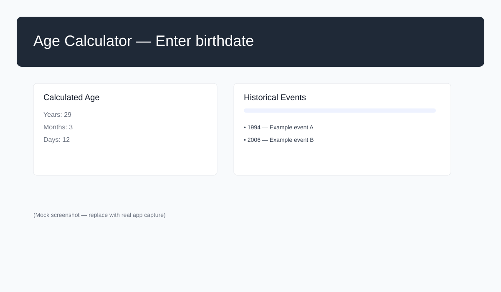
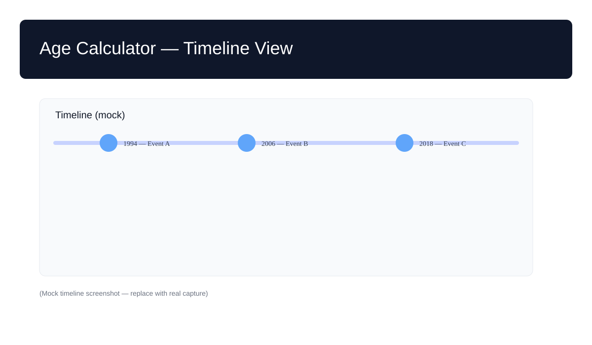

<div align="center">
<h1>Age Calculator</h1>
</div>

Simple web app that calculates a person's age from their birthdate and shows related historical events.

**Live demo:** https://ai.studio/apps/drive/1hw3CPsHFrre93tpKFAN3ETMXSlcHjtz6

**Quick overview**
- Calculate age in years, months, weeks, days and hours
- Fetch historical events between birth year and current year
- Display events and timeline

**Quick Start**

1. Install prerequisites

   - Node.js (v16+ recommended)

2. Clone and install

```bash
git clone https://github.com/google-gemini-v-flash/age-calculator.git
cd age-calculator
npm install
```

3. Configure environment

   - Create a `.env.local` file at the project root with:

```
GEMINI_API_KEY=YOUR_API_KEY
```

4. Run in development

```bash
npm run dev
```

Open the app at `http://localhost:5173` (Vite default) and enter a birthdate to see results.

**Usage**

- Enter a birthdate in the UI and submit.
- The app displays age breakdown and a list/table of historical events that fall between the birth year and the current year.
- Invalid dates or future dates are validated and reported in the UI.

**Project structure**

- [index.html](index.html) — App shell
- [index.tsx](index.tsx) — Root React entry
- [src/main.ts](src/main.ts) — App bootstrap
- [src/components/age-display.ts](src/components/age-display.ts) — Shows calculated age
- [src/components/timeline.ts](src/components/timeline.ts) — Timeline / events UI
- [src/services/age-calculator.ts](src/services/age-calculator.ts) — Age calculation logic
- [src/services/event-service.ts](src/services/event-service.ts) — Loads events (uses Gemini)
- [public/events.json](public/events.json) — Example events data

**Configuration & environment**

- `GEMINI_API_KEY` — required to fetch events via Gemini. When not present the app may fall back to `public/events.json`.

**Development notes**

- Build: `npm run build`
- Preview production build: `npm run preview`
- Lint / format: follow repo scripts (if present in `package.json`)

**Testing the core functions locally**

- To quickly test the age calculation logic, inspect or run small scripts against [src/services/age-calculator.ts](src/services/age-calculator.ts).

**Where to edit UI**

- Components live under [src/components](src/components) (see `age-display.ts` and `timeline.ts`).

**Next steps / suggestions**

- Add unit tests for `age-calculator.ts` and `event-service.ts`.
- Add CI to run tests and linting on push.
- Provide a small screenshots or demo GIF in this README.

---

If you want, I can also add example screenshots, create a `CONTRIBUTING.md`, or add unit tests for the core services. Tell me which you prefer next.

**Screenshots**

Below are demo screenshots showing the app UI (mock captures). Replace these with real screenshots by updating files in [public/screenshots](public/screenshots).




